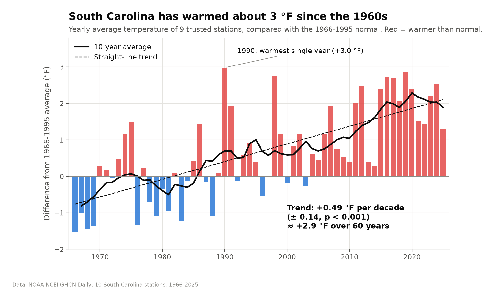

# Is South Carolina Heating Up?

**Three angles on 60 years of NOAA weather data (1966–2025)**



This project downloads daily weather records for 10 long-running South Carolina
weather stations from NOAA NCEI, cleans them, checks them for problems, and
looks at climate change in the state from three angles. Every chart is made with
Matplotlib, and one command rebuilds every number and figure.

| Deliverable | File |
|---|---|
| Report | [report/Project_Report.pdf](report/Project_Report.pdf) ([.docx](report/Project_Report.docx)) |
| Slides (with speaker notes) | [presentation/SC_Climate_Presentation.pptx](presentation/SC_Climate_Presentation.pptx) ([.pdf](presentation/SC_Climate_Presentation.pdf)) |
| Speaker script | [presentation/Speaker_Script.pdf](presentation/Speaker_Script.pdf) |
| Presentation video | **[YouTube link – add after uploading]** |

---

## Quick start

Requires Python 3.9 or newer.

```bash
git clone <this repository's URL>
cd SC-Climate-Shift
pip install -r requirements.txt
python run_all.py
```

`run_all.py` takes about 20 seconds. It uses the NOAA data that is already in
`data/raw/`, so no internet is needed. To download fresh data from NOAA first:

```bash
python run_all.py --download
```

Each step can also be run on its own, for example `python src/angle1_where.py`
(run `python src/clean_data.py` first so the processed data exists).

---

## The question and the three angles

> What has actually changed in South Carolina's weather over the last 60 years –
> **where**, **when**, and **how do people feel it**?

| Angle | Question | Why it makes sense |
|---|---|---|
| **1. Where** | Which South Carolina city has warmed the most? | Tells us if warming is local or statewide and ranks cities for local planning (the assignment's example question). |
| **2. When** | Is it warming more by day or by night? In which season? | The yearly average hides *how* it warms. Night vs. day points to causes like city heat; seasons matter for crops and energy. |
| **3. What people feel** | Are extreme days becoming more common? | People feel thresholds, not averages: a 95 °F afternoon, a night that never cools, a frost, a flood. Also tests rain, a second variable. |

Together they move from **the average** → **its timing** → **the extremes**.

## Key findings

- **Where:** South Carolina warmed **+0.49 °F per decade** (p < 0.001) – about
  **+2.9 °F since 1966** – and every trusted station warmed significantly.
  **Columbia** warmed fastest (+0.58 °F/decade), statistically tied with
  Greenville-Spartanburg, Beaufort and Charleston Airport.
- **When:** nights warm faster than days (+0.55 vs +0.43 °F/decade), most of all
  in downtown Charleston and Columbia (urban heat island). **Winter** warms
  1.7× faster than the other seasons.
- **What people feel:** **+47% warm nights** (low ≥ 75 °F), **−18% freeze days**,
  a freeze-free season about **3 weeks longer**, +21% hot days (≥ 95 °F).
  Heavy rain shows **no significant trend** (p = 0.56).
- **Data check:** the Sumter station's thermometer read up to 5 °F too cold
  around 2010–2015, so it is left out of statewide temperature averages.

A full summary is written to [results/key_findings.md](results/key_findings.md) every time the code runs.

## Data

- **Source:** NOAA National Centers for Environmental Information,
  [Global Historical Climatology Network – Daily (GHCN-Daily)](https://www.ncei.noaa.gov/products/land-based-station/global-historical-climatology-network-daily),
  the database behind NOAA's [Past Weather](https://www.ncei.noaa.gov/access/past-weather/Charleston%2C%20South%20Carolina) pages.
- **Download URL pattern:** `https://www.ncei.noaa.gov/data/global-historical-climatology-network-daily/access/<STATION_ID>.csv`
- **Stations (10):** Charleston Airport, Charleston Downtown, Beaufort (Coast) ·
  Columbia, Florence, Sumter (Midlands) · Greenville-Spartanburg, Anderson,
  Clemson, Rock Hill (Upstate). IDs are in [src/config.py](src/config.py).
- **Variables:** daily high (TMAX), daily low (TMIN), rain (PRCP).
- **State outline** for the maps: [PublicaMundi us-states GeoJSON](https://github.com/PublicaMundi/MappingAPI) (`data/sc_boundary.csv`).

## Repository structure

```
SC-Climate-Shift/
├── run_all.py               runs every step in order
├── requirements.txt
├── src/
│   ├── config.py            stations, years, thresholds, colours
│   ├── download_data.py     Task 1 – download the NOAA data
│   ├── clean_data.py        cleaning + yearly measures
│   ├── quality_check.py     station map + neighbour check   (fig 1–2)
│   ├── angle1_where.py      Angle 1 – where                 (fig 3–6)
│   ├── angle2_when.py       Angle 2 – when                  (fig 7–8)
│   ├── angle3_extremes.py   Angle 3 – extremes              (fig 9–12)
│   └── utils.py             trend statistics + shared Matplotlib style
├── data/
│   ├── raw/                 downloaded NOAA files (trimmed to the columns used)
│   ├── processed/           cleaned daily data + yearly table (rebuilt by run_all.py)
│   └── sc_boundary.csv      South Carolina outline for the maps
├── figures/                 12 charts (PNG); figures/slides/ = slide versions
├── results/                 result tables (CSV) + key_findings.md
├── report/                  project report (PDF + Word)
└── presentation/            slides (PPTX + PDF) and speaker script
```

## Methods in short

1. **Clean:** convert tenths of °C / mm to °F / inches, drop values that failed
   NOAA's quality flags, drop impossible days, keep only years with ≥ 330 days.
2. **Check:** compare each station with the average of the other nine; flag any
   station whose 5-year average difference drifts more than 3 °F.
3. **Analyse:** least-squares linear trend per decade with 95% confidence interval
   and p-value (`scipy.stats.linregress`), plus 1966–1995 vs 1996–2025 averages.
4. **Visualise:** Matplotlib with one shared style – one message per chart,
   colour-blind-safe palette, direct labels, error bars, no dual axes.

---

*Course project – [Your Name], [Course name], [Semester].*
